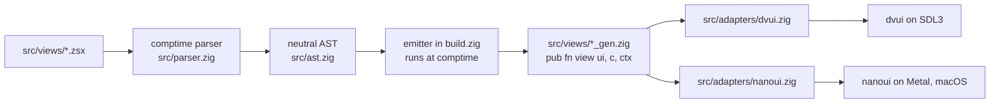

<div align="center">
  
  <p>
    <strong>A JSX-like view syntax that compiles to native Zig GUI code at comptime</strong><br/>
    Zsx embeds your <code>.zsx</code> markup at build time, parses it with a comptime parser, and emits
    plain Zig builder calls into generated source files — no runtime parser, no dynamic dispatch.
    It is for Zig developers building apps with dvui, nanoui, or HTML who want declarative views
    without giving up their toolkit. The 15-component playground in <code>src/views/playground.zsx</code>
    renders from one source through all three adapters, and CI builds each real binary on every push.
  </p>
  <p>
    <a href="https://github.com/elcoosp/zsx/blob/main/.github/workflows/ci.yml"></a>
    <a href="https://github.com/elcoosp/zsx/blob/main/build.zig.zon"></a>
    <a href="https://github.com/elcoosp/zsx/tree/main/src/adapters"></a>
    <a href="https://github.com/elcoosp/zsx/blob/main/LICENSE"></a>
    <a href="https://github.com/elcoosp/zsx/blob/main/TEMPLATE.md"></a>
  </p>
</div>

<p align="center">
  <a href="#quickstart">Quickstart</a> • <a href="#features">Features</a> • <a href="#how-it-works">How it works</a> • <a href="#usage">Usage</a> • <a href="#status">Status</a> • <a href="#learn-more">Learn more</a>
</p>

## Quickstart

Prerequisites: Zig 0.17.0 or later (CI runs 0.17.1); SDL3 and freetype only for the dvui binary.

```bash
git clone https://github.com/elcoosp/zsx
cd zsx
zig build test      # regenerates _gen.zig files, then runs unit and stub tests
zig build example   # headless demo: renders src/views/demo.zsx through a stub toolkit
```

`zig build test` regenerates every `src/views/*_gen.zig` from its `.zsx` source as a build step, so markup changes are picked up without a separate command. `zig build example` runs `src/hello.zig`, which drives the same generated view against an in-memory stub and prints how many widgets rendered and whether the `on_click` handler fired.

To open real windows:

```bash
zig build build-app-dvui      # needs SDL3 + freetype (e.g. brew install sdl3 freetype)
./zig-out/bin/zsx-hello-dvui

zig build build-app-nanoui    # macOS only; nanoui renders through Metal
./zig-out/bin/zsx-hello-nanoui
```

Both binaries display the same 13-component playground defined once in `src/views/playground.zsx`.

To start your own project from this tree:

```bash
./scripts/new-project.sh ~/code/my-app my-app
```

That copies the repo, renames the package, generates a fresh fingerprint, and initializes a git repo you own. See [TEMPLATE.md](TEMPLATE.md) for why zsx is a template rather than a `zig fetch` package.

## Not quite TSX

`zsx!{ <markup> }` is **not** Zig syntax. The Zig compiler has never heard of `zsx!{` — a `.zsx` file cannot be handed to `zig build-exe` directly.

```
src/views/demo.zsx      input to the preprocessor
        v
src/views/demo_gen.zig  expanded to plain Zig at build time
        v               (this is the only file Zig compiles)
   test / binary
```

`src/preprocess.zig` scans for `zsx!{ ... }` blocks, parses the markup at comptime, and emits plain `ui.column(c, .{...})` / `ctx.Button(ui, c, .{...})` calls. Zig never sees markup.

Closest mainstream analog: **Svelte** or **Vue SFC** (`.svelte` / `.vue` → `.js`), or **SCSS** (`.scss` → `.css`), not TSX. TSX works because TypeScript's own parser understands JSX. True TSX parity would need a Zig compiler change, out of scope.

## Features

- **Two pipelines, one contract.** Both take `.zsx` sources and produce the same `pub fn view(ui, c, ctx)` shape; they differ only in when they run. **Comptime** (default in-repo): `build.zig` embeds each `.zsx` with `@embedFile`, `src/parser.zig` parses at comptime, `src/codegen.zig` writes plain Zig to `src/views/*_gen.zig` (gitignored). **Runtime** (fetchable): `zsx.addViews(b, opts)` builds `zsx-gen` and runs it at build time, writing `.zig` to `.zig-cache` — no source-tree generated files, works as a dependency. Release binaries carry no parser in either mode, only the builder calls you would have written by hand.
- **One source, three toolkits.** The same view renders through `src/adapters/dvui.zig` (dvui on SDL3), `src/adapters/nanoui.zig` (nanoui on Metal), and `src/adapters/html.zig` (plain HTML for the web). Each adapter implements one primitive surface — `column`, `row`, `text`, `button`, `textEntry`, `textArea`, `checkbox`, `progress`, `divider`, `slider`, `toggle`, `skeleton` — and the generated code only speaks that surface.
- **Control flow in markup, native code out.** `{if}`, `{else if}`, `{else}`, and `{for items as item}` lower to literal Zig `if`/`for` statements in the generated file. Widget IDs in loops get stable index arithmetic (`id + idx_0`), so identity survives dynamic item counts.
- **Styling resolved at comptime.** A Tailwind-named class subset (`bg-blue-500`, `p-4`, `gap-2`, `font-bold`, `rounded-lg`, ...) is mapped by `src/style.zig` to concrete colors, spacing, and font values during compilation. An unrecognized class is a compile error, not a silently unstyled widget.
- **15 shadcn-inspired components.** `src/lib/shadcn.zig` defines `Button`, `Input`, `Textarea`, `Checkbox`, `Card`, `Section`, `Badge`, `Heading`, `Caption`, `Link`, `Progress`, `Divider`, `Slider`, `Switch`, and `Skeleton` as pure compositions of adapter primitives. A view exposes them by declaring them on its context struct — no codegen changes needed.
- **Errors surface in your markup, not at runtime.** Unknown tags, bare text children, unclosed control flow, and non-comptime classes all fail compilation with targeted messages such as `zsx: bare text child; wrap in <label>`.

## Developer workflow

`_gen.zig` files are generated, gitignored, and hidden from the editor by the configs shipped in this repo (`.vscode/`, `.zed/`, `.idea/`). See [docs/DX.md](docs/DX.md) for:
- What's on disk vs. what you see in the editor
- Fresh-clone behavior (ZLS regenerates automatically on first save)
- How to commit generated files if your team prefers that
- How to see generated files in the editor anyway

## For external consumers

zsx is fetchable. A consumer project adds it as a dependency, calls `zsx.addViews` from `build.zig`, and imports the generated views by name. **No fork, no `_gen.zig` in source tree, generated files land in `.zig-cache`.**

```zig
// build.zig.zon
.dependencies = .{
    .zsx = .{
        .url = "git+https://github.com/elcoosp/zsx#v0.1.0",
        .hash = "zsx-0.1.0-AAAA...",
    },
},
```

```zig
// build.zig
const zsx = @import("zsx");

pub fn build(b: *std.Build) void {
    const target = b.standardTargetOptions(.{});
    const optimize = b.standardOptimizeOption(.{});

    const views = zsx.addViews(b, .{
        .paths = &.{ "src/views/home.zsx", "src/views/about.zsx" },
        .target = target,
        .optimize = optimize,
    });

    const app = b.createModule(.{
        .root_source_file = b.path("src/main.zig"),
        .target = target, .optimize = optimize,
    });
    for (views) |v| app.addImport(v.name, v.module);

    b.installArtifact(b.addExecutable(.{ .name = "app", .root_module = app }));
}
```

```zig
// src/main.zig
const home = @import("home");
const about = @import("about");
```

**One rule that changes from in-repo usage:** `.zsx` files must use **named imports** (`@import("shadcn")`), not relative paths (`@import("../lib/shadcn.zig")`). Relative paths can't resolve from `.zig-cache`. Wire named imports via `zsx.addViews(b, .{ .imports = &.{ .{ .name = "shadcn", .module = shadcn_mod } } })`.

See [`examples/consumer/`](examples/consumer/) for a working end-to-end example (`cd examples/consumer && zig build run`).

## How it works

Each `.zsx` file listed in `build.zig` is embedded and parsed at comptime into a neutral element tree (`src/ast.zig`). Two emitters walk that tree and produce a `view(ui, c, ctx)` function:

- **Comptime** (`src/codegen.zig`): called from `build.zig`, writes `src/views/<name>_gen.zig`.
- **Runtime** (`src/rt/codegen.zig` via `src/gen.zig` and `zsx.zig`): invoked by `zsx.addViews` from a consumer's `build.zig`, writes `.zig-cache/<hash>/<name>.zig`. At runtime, your app calls that function once per frame with an adapter and your context struct; the adapter translates the primitive calls into dvui or nanoui widget code. Component tags (`<Button ...>`) compile to calls back into your context, so components are resolved by Zig's own comptime dispatch.



## Usage

A view is a single root element with Zig expressions in `{}`. This is `src/views/demo.zsx` in full:

```zsx
<column padding={16} class="gap-2">
  {if ctx.show_save}
    <button class="bg-blue-500 text-white px-4 py-2" on_click={ctx.save()}>Save</button>
  {else}
    <label class="text-gray-500">No actions</label>
  {endif}
  {for ctx.items as item}
    <label class="text-lg font-bold">{item}</label>
  {endfor}
</column>
```

`zig build test` generates `src/views/demo_gen.zig` from it:

```zig
pub fn view(ui: anytype, c: anytype, ctx: anytype) void {
    {
        var b_0 = ui.column(c, .{.id_extra = 0, .padding = .{ .x = 16, .y = 16, .w = 16, .h = 16 }, .gap = 8});
        defer b_0.end();
        if (ctx.show_save) {
            if (ui.button(c, "Save", .{.id_extra = 1, .color_fill = .{ .r = 59, .g = 130, .b = 246, .a = 255 }, .color_text = .{ .r = 255, .g = 255, .b = 255, .a = 255 }, .padding = .{ .x = 16, .y = 8, .w = 16, .h = 8 }})) ctx.save();
        } else {
            ui.text(c, "No actions", .{.id_extra = 2, .color_text = .{ .r = 107, .g = 114, .b = 128, .a = 255 }});
        }
        for (ctx.items, 0..) |item, idx_0| {
            ui.text(c, item, .{.id_extra = 3 + idx_0, .font_size = 18, .font_weight = 700});
        }
    }
}
```

The grammar is a strict subset of HTML with Zig in braces:

| Construct | Example |
|---|---|
| Layout primitives | `<column>`, `<row>`, `<label>`, `<button>` |
| Self-closing component | `<Input buffer={&ctx.name} placeholder="Your name" />` |
| Path-qualified component | `<shadcn.Button variant="primary">Save</shadcn.Button>` |
| Boolean attribute | `<column flex />` |
| Value attribute | `<column padding={16} />` |
| String attribute | `<label class="text-lg font-bold">` |
| Text expression | `<label>{item}</label>` |
| Conditional | `{if ctx.flag} ... {else if other} ... {else} ... {endif}` |
| Loop | `{for ctx.items as item} ... {endfor}` |
| Fragment | `<>...</>` |

Click handlers must be written as `on_click={ctx.method()}`; the emitter rewrites them to a call through the context pointer. Bare text inside layout elements such as `<column>` or `<row>` is rejected at compile time — wrap it in `<label>` instead. Components accept text children, which the emitter lowers to `text` calls.

Your app wires a context struct, an adapter, and the generated view. Excerpt from `src/hello_dvui.zig`:

```zig
const dvui = @import("dvui");
const playground = @import("views/playground_gen.zig");
const adapter = @import("adapters/dvui.zig");

const Ctx = struct {
    pub const Button = @import("lib/shadcn.zig").Button;
    pub const Input = @import("lib/shadcn.zig").Input;
    // one decl per component the view uses
    name: [64]u8 = @splat(0),
    remember: bool = false,
    completion: f32 = 0.42,
};

var g_ctx: Ctx = .{};
const A = adapter.Adapter(dvui);

fn frame() !dvui.App.Result {
    // ... window setup ...
    playground.view(A, win, &g_ctx);
    return .ok;
}
```

To add a view, create `src/views/your_view.zsx`, add its path to `zsx_files` in `build.zig`, and run `zig build test` — the `_gen.zig` file appears next to it. Components, their attributes, and per-backend limitations are documented in [docs/components.md](docs/components.md).

## Status

> [!NOTE]
> This is a young project (version 0.0.1); expect breaking changes to the `.zsx` grammar and the adapter surface. It targets Zig 0.17.0 or later and is tested in CI on 0.17.1 across ubuntu-latest and macos-latest. Both real binaries are built on macOS every push; the nanoui backend is macOS-only (Metal), and the dvui backend needs SDL3 and freetype installed. The fetchable path (`zsx.addViews` in a consumer's `build.zig`) is production-ready; see [`examples/consumer/`](examples/consumer/) for a working end-to-end demo. Known limitations, all listed in [docs/components.md](docs/components.md): class strings must be compile-time constants, `m-*` margin classes are rejected, dvui headings fall back to the theme font weight, and nanoui ignores `id_extra` on checkboxes.

## Learn more

- [docs/components.md](docs/components.md) — API reference for all 13 components, with examples and per-backend notes.
- [TEMPLATE.md](TEMPLATE.md) — why zsx ships as a template instead of a package, and the fork workflow.
- [ROADMAP.md](ROADMAP.md) — the phased plan, including future backends such as zigui, Capy, and a web emitter.
- [docs/zig-skill.md](docs/zig-skill.md) — a Zig 0.17 reference of compiler errors and fixes, used while building this repo.

## Fresh-clone regeneration

`src/views/*_gen.zig` files are generated by the build system and are
listed in `.gitignore` — same convention as `tsc` and the `.js` it
produces from `.tsx`.

After `git clone` (or `new-project.sh`), run `zig build test` once
before opening the project in your editor. That regenerates every
`_gen.zig` file so ZLS can resolve `@import("views/demo_gen.zig")`.
Every subsequent `zig build <target>` will also regenerate any missing
`_gen.zig` because `zsx_update` is a dependency of every build step
that uses a view.

If you prefer to commit `_gen.zig` (some teams do, for reviewability),
delete the `src/views/*_gen.zig` line from `.gitignore`.

